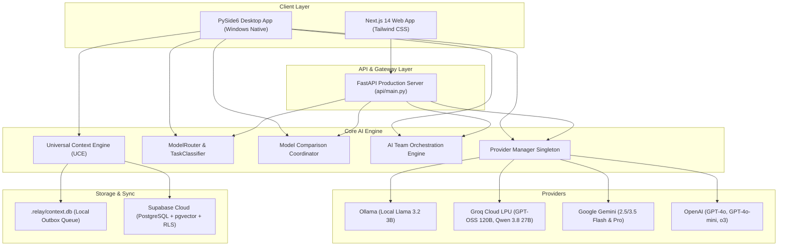
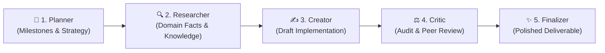

# Relay AI

> **Think together. Work smarter.**

[]()
[]()
[]()
[]()
[]()
[]()

Relay AI is a dual-platform (Native Windows Desktop + Modern Web) multi-model collaboration workspace and context engine. It unifies on-device local AI inference (via Ollama) with frontier cloud language models (Groq, Google Gemini, OpenAI) behind intelligent intent routing, side-by-side benchmark comparison, and autonomous multi-agent team workflows.

---

## 1. Problem Statement & Objectives

Modern AI applications force developers and knowledge workers into siloed proprietary interfaces. Users are constrained to single-model interactions, suffer vendor lock-in, face high latency or costs for routine tasks, and lack collaborative multi-agent peer review mechanisms.

**Relay AI solves this by delivering:**
- **Zero-Friction Multi-Model Access:** Seamlessly alternate between local and cloud models without context loss.
- **Intelligent Intent & Complexity Routing:** Automatically evaluates prompt complexity and domain (code, math, reasoning, vision) to route tasks to the optimal engine.
- **Side-by-Side Model Benchmarking:** Concurrently runs identical queries across 2 to 4 models with live tokens/sec speed and latency metrics.
- **Autonomous Multi-Agent Pipelines:** Coordinates specialized agents (Planner → Researcher → Creator → Critic → Finalizer) to produce vetted deliverables.
- **Air-Gapped Local Privacy & Cloud Sync:** Keeps API credentials encrypted in the OS Credential Locker, supports 100% offline local inference, and offers optional Supabase cloud synchronization.

---

## 2. System Architecture



---

## 3. Key Features

### ✦ Multi-Provider AI Inference
- **Ollama (Local)**: High-speed, offline-first on-device inference via `llama3.2:3b`. Zero external network dependency.
- **Groq Cloud (LPU)**: Ultra-low latency inference using the official Groq SDK (`openai/gpt-oss-120b`, `qwen/qwen3.8-27b`, `llama-3.3-70b-versatile`).
- **Google Gemini (Cloud)**: Developer API integration for deep context tasks and vision (`gemini-2.5-flash`, `gemini-2.5-pro`).
- **OpenAI (Cloud)**: Industry standard reasoning and instruction execution (`gpt-4o-mini`, `gpt-4o`, `o3`).

### ✦ Autonomous Multi-Agent Teams
Execute complex development and analysis tasks using a directed, feedback-driven 5-stage agent workflow:



1. **Planner**: Deconstructs user prompt into milestones and constraints.
2. **Researcher**: Gathers architectural points, syntax specifications, and edge-cases.
3. **Creator**: Synthesizes the core implementation and comprehensive solution.
4. **Critic**: Audits deliverable against quality requirements and proposes refinements.
5. **Finalizer**: Resolves peer critiques and formats the polished final release.

### ✦ Side-by-Side Model Comparison
- Run prompts concurrently across 2 to 4 models with independent streaming worker threads.
- Real-time performance tracking: latency (seconds), token counts, and token generation speed (tokens/sec).
- Selective context commitment: Choose the best response ("✓ Commit to Chat") to append to the active thread, avoiding context bloat.

### ✦ Intelligent Task Routing
- Automated intent and complexity classification (`CODING`, `COMPLEX_REASONING`, `MATH`, `CREATIVE`, `VISION`, `GENERAL`).
- Dynamic fallback routing between local and cloud providers based on credential availability and network health.
- Local-Only toggle: Guarantees zero cloud calls when handling proprietary or confidential data.

### ✦ Multimodal Vision & Speech-to-Text Dictation
- **Attachment Menu (`+`)**: Supports Camera captures, Photos, and Documents (PDF, DOCX, TXT, CSV, JSON).
- **Vision Engine**: Encodes images to base64 and auto-routes queries to vision-capable engines.
- **Voice Dictation**: Low-latency microphone recording via native Qt multimedia capture paired with sub-second (~0.3s) Whisper transcription.

### ✦ Strict Monochromatic Design System
- Engineered around a focused, distraction-free aesthetic:
  - **Raven**: `#202124` (Deep background surfaces)
  - **Charcoal**: `#36454F` (Panels, cards, and active indicators)
  - **Pure White**: `#FFFFFF` (High-contrast typography and primary actions)
  - **Mid-tone Gray**: `#757575` (Secondary text, metadata, and borders)
- Seamless theme toggle between complementary Dark and Light modes without requiring an application restart.

---

## 4. Technology Stack

| Layer | Technologies |
| :--- | :--- |
| **Desktop Application** | Python 3.11+, PySide6 (Qt 6.7+), QThread concurrency, WinVaultKeyring (DPAPI) |
| **Web Frontend** | Next.js 14 (App Router), React 18, TypeScript, Tailwind CSS |
| **Backend API** | FastAPI, Uvicorn, Pydantic v2, Python `ThreadPoolExecutor` |
| **AI SDKs** | `groq>=0.9.0`, `google-genai>=0.1.1`, `openai>=1.12.0`, `httpx>=0.27` |
| **Context & Storage** | SQLite (`.relay/context.db`), Supabase Cloud (PostgreSQL, pgvector, Row Level Security) |
| **Deployment** | Render (FastAPI Web Service), Vercel (Next.js Edge Platform) |

---

## 5. Repository Structure

```text
Relay-Ai/
├── api/                        # FastAPI Production Web Backend
│   ├── __init__.py
│   └── main.py                 # REST & SSE streaming endpoints (chat, route, compare, teams)
├── web/                        # Next.js 14 Modern Web Platform
│   ├── src/
│   │   ├── app/                # App Router (layout.tsx, page.tsx, globals.css)
│   │   └── lib/                # API client (api.ts) & Supabase client (supabase.ts)
│   ├── package.json
│   ├── tailwind.config.ts      # Monochromatic design system tokens
│   └── vercel.json
├── src/                        # Core AI Engine & Desktop Framework
│   ├── context/                # Universal Context Engine (UCE)
│   │   ├── auth/               # Supabase Auth session manager
│   │   ├── db/                 # Local SQLite database migrations & schema
│   │   ├── documents/          # Document chunking, parsing, and storage
│   │   ├── retrieval/          # Hybrid RAG (Reciprocal Rank Fusion + FTS + Vector)
│   │   └── sync/               # Transactional outbox sync queue and background worker
│   ├── core/                   # Shared data structures (Message, Comparison, Security)
│   ├── providers/              # Multi-provider integrations (Groq, Gemini, OpenAI, Ollama)
│   ├── routing/                # Smart Intent Router, TaskClassifier, ModelCapabilityRegistry
│   ├── teams/                  # Multi-agent team workflow coordinator
│   ├── ui/                     # PySide6 desktop UI views
│   │   ├── main_window.py      # Primary desktop application shell
│   │   ├── compare_view.py     # Side-by-side model comparison grid
│   │   ├── attachment_menu.py  # Modal popup for camera, photos, and documents
│   │   ├── theme.py            # Centralized monochromatic QSS theme manager
│   │   └── teams/              # AI Teams timeline, agent cards, and deliverable panels
│   └── voice/                  # Speech-to-text dictation & voice assistant controller
├── supabase/                   # Supabase Cloud Database Schema
│   └── migrations/             # PostgreSQL migrations with Row Level Security (RLS)
├── tests/                      # Comprehensive Unit & Regression Test Suite
├── app.py                      # Desktop Application Entry Point
├── render.yaml                 # Render Blueprint deployment configuration
├── Procfile                    # Cloud process declaration for FastAPI
├── requirements.txt            # Python production dependencies
├── .env.example                # Environment variable configuration template
└── README.md
```

---

## 6. Getting Started

### Prerequisites
- Python 3.11+ installed (64-bit recommended)
- Node.js 18+ and npm 9+ (for web platform)
- *(Optional)* [Ollama](https://ollama.ai) installed locally if using offline inference

### 1. Clone & Set Up Python Virtual Environment
```powershell
git clone https://github.com/sambhav824/Relay-AI.git
cd Relay-Ai

# Create and activate virtual environment
python -m venv .venv
.\.venv\Scripts\Activate.ps1

# Install dependencies
python -m pip install -r requirements.txt
```

### 2. Environment Configuration
Copy the template file to set up your environment:
```powershell
cp .env.example .env
```

Configure your credentials inside `.env` (or via the desktop Settings UI):
```env
GROQ_API_KEY=your_groq_api_key_here
GEMINI_API_KEY=your_gemini_api_key_here
OPENAI_API_KEY=your_openai_api_key_here
SUPABASE_URL=https://your-project-id.supabase.co
SUPABASE_ANON_KEY=your_supabase_anon_key_here
```

---

## 7. Running the Applications

### A. Run Desktop Application (PySide6)
```powershell
python app.py
```
*Launches the native Windows desktop client with the centralized monochromatic dark/light interface, voice dictation, smart routing, model comparison, and AI teams.*

### B. Run Production FastAPI Backend
```powershell
uvicorn api.main:app --host 127.0.0.1 --port 8000
```
- Interactive Swagger API docs: `http://127.0.0.1:8000/docs`
- Health check endpoint: `http://127.0.0.1:8000/health`

### C. Run Web Platform (Next.js)
```powershell
cd web
npm install
npm run dev
```
Open `http://localhost:3000` in your browser.

---

## 8. Verification & Testing

Execute the comprehensive test suite across providers, routing, multi-agent teams, and UI:

```powershell
# Run all unit tests
python -m unittest discover -s tests -p "test_*.py"

# Run voice assistant and multimodal attachment tests
python -m unittest tests/test_voice_assistant.py tests/test_chat_attachments.py

# Verify production Next.js build
cd web
npm run build
```

---

## 9. Deployment Architecture

### Backend Deployment (Render)
The repository includes a ready-to-deploy [render.yaml](render.yaml) specification:
1. Connect this repository to [Render](https://dashboard.render.com).
2. Select **New Blueprint Instance**.
3. Supply `GROQ_API_KEY`, `GEMINI_API_KEY`, and `OPENAI_API_KEY` in Render Environment settings.
4. Render automatically runs `pip install -r requirements.txt` and starts Uvicorn.

### Frontend Deployment (Vercel)
1. Import the repository on [Vercel](https://vercel.com/new).
2. Set the **Root Directory** to `web`.
3. Configure the environment variable:
   - `NEXT_PUBLIC_API_URL`: Your deployed Render API URL (e.g., `https://relay-ai-0r5f.onrender.com`).
4. Click **Deploy**.

---

## 10. Security & Privacy Model

- **OS Keyring Encryption**: Desktop credentials are encrypted in the Windows Credential Locker using DPAPI. Keys are never logged or stored in plaintext.
- **Server-Side Key Isolation**: Cloud inference API keys are handled strictly within the FastAPI backend; zero private API keys are bundled into frontend browser scripts.
- **Row Level Security (RLS)**: Supabase PostgreSQL tables enforce `auth.uid() = user_id` policies preventing cross-tenant data exposure.
- **Local Isolation Guarantee**: The local-only mode confines queries to the on-device Ollama daemon, preventing any data from traversing the public internet.

---

## 11. Implementation Status & Roadmap

### ✅ Completed & Production Verified
- [x] Multi-Provider Engine (Local Ollama, Groq LPU, Google Gemini, OpenAI).
- [x] Side-by-side model comparison grid (2 to 4 models) with live tokens/sec speed.
- [x] Intelligent Intent & Complexity Router with deterministic cue matching.
- [x] Autonomous 5-agent team pipeline (Planner → Researcher → Creator → Critic → Finalizer).
- [x] Multimodal image attachment parsing and sub-second Groq Whisper speech-to-text dictation.
- [x] Centralized monochromatic UI Design System (Raven, Charcoal, White, Gray).
- [x] Production FastAPI backend with REST & SSE streaming endpoints.
- [x] Next.js 14 responsive web platform matching the desktop feature set.
- [x] Zero-leak git security controls and automated build pipelines.

### 🔮 Future Development Roadmap
- [ ] Enterprise SSO / SAML integration via Supabase Auth.
- [ ] WebRTC bidirectional continuous real-time voice conversations.
- [ ] Distributed swarm agent orchestration across independent Docker containers.
- [ ] Direct export of AI Team deliverables to GitHub Pull Requests and Linear issues.

---

## 12. Community & Contribution

Contributions and feature requests are welcome. Please read [CONTRIBUTING.md](CONTRIBUTING.md) for details on code style, testing standards, and development workflows.
