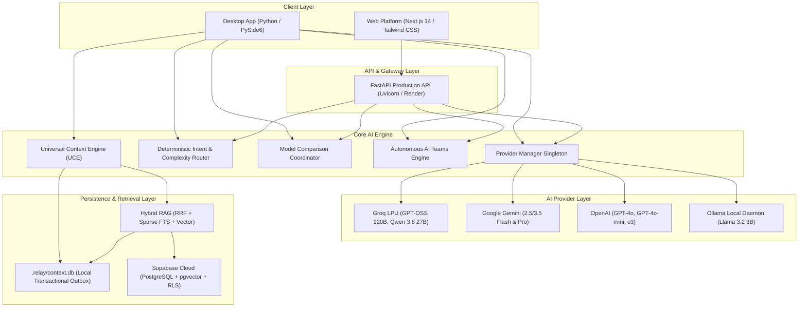
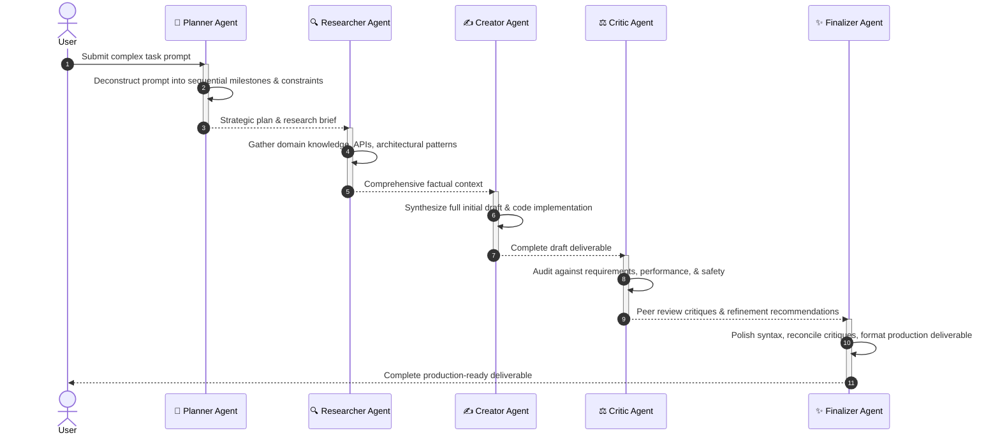

# Relay AI — Technical Architecture Specification

## Overview

Relay AI is a dual-platform (Native Windows Desktop + Cloud Web) multi-model collaboration system engineered with Python, PySide6, Next.js, and FastAPI. It unifies local inference (Ollama) with frontier cloud inference (Groq, Gemini, OpenAI) behind a single context and orchestration bus.

---

## 1. High-Level System Architecture

---

## 2. Autonomous AI Teams: Sequential 5-Agent Pipeline

Relay AI organizes multi-agent execution in a directed, feedback-driven pipeline where each agent is constrained to its specialization:

---

## 3. Intelligent Model Routing

The `ModelRouter` evaluates user prompts using deterministic lexical cues and complexity scoring:

- **Coding Tasks (`TaskType.CODING`)**: Dispatches to models with high code benchmarks and long context (e.g., `openai/gpt-oss-120b` or `gpt-4o-mini`).
- **Complex Reasoning (`TaskType.COMPLEX_REASONING`)**: Routes to high-depth reasoning engines.
- **Vision Tasks (`TaskType.VISION`)**: Automatically identifies base64 image attachments and filters for models with native multimodal support (`gemini-2.5-flash`, `gpt-4o-mini`).
- **Local-Only Guardrail**: When enabled, guarantees queries never exit the local network, isolating execution to local Ollama inference.

---

## 4. Security & Credential Isolation

- **OS Keyring Integration (`WinVaultKeyring` / `DPAPI`)**: Windows desktop stores all API keys inside the encrypted Windows Credential Locker. Plaintext keys are never stored in `.env` files, configuration files, or logs.
- **Server-Side Environment Fallback**: On Linux / Render deployment, `CredentialStore` falls back to process environment variables (`GROQ_API_KEY`, `GEMINI_API_KEY`, `OPENAI_API_KEY`) without client exposure.
- **Zero Frontend Leakage**: The Next.js frontend interacts strictly via backend API proxy or public anon keys; secret tokens (`SUPABASE_SERVICE_ROLE_KEY`) are never exposed to browser bundles.
