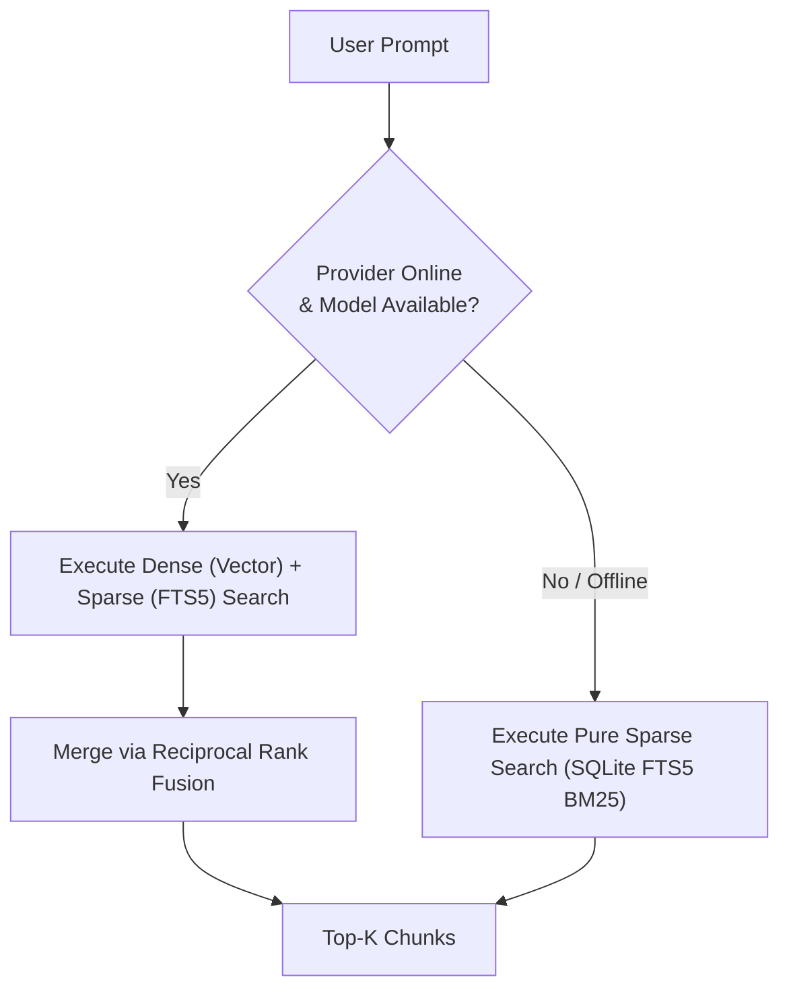

# Relay AI — Milestone 10.4: Vector & Hybrid Retrieval Engine
## Architecture Specification, pgvector Schema & Master Implementation Plan (Final Architecture Review)

**Target Branch:** `feat/milestone-10-4-vector-hybrid-retrieval`  
**Base Branch:** `main`  
**Status:** Architecture Validated & Finalized — Ready for Implementation Approval  
**Prerequisites:** Milestone 10.2 (Cloud Sync) & Milestone 10.3 (Document Ingestion) merged into `main`.

---

## 1. Executive Summary & Review Invariants

Milestone 10.4 establishes dense vector embeddings, vector similarity search, and hybrid retrieval for Relay AI's Universal Context Engine (UCE).

Following comprehensive architectural review, the core architectural decisions and invariants are:
1. **Cache Identity & Collision Prevention**: The SQLite `embedding_cache` uses a composite primary key `(content_hash, model_id, dimension)`. Different models, versions, or dimension configurations for identical text content reside in distinct cache entries and never collide.
2. **Dual-Vector Column Architecture**: `public.document_chunks` hosts two typed vector columns: `embedding_1536 vector(1536)` and `embedding_768 vector(768)`. Chunks are strictly tagged with `embedding_model` and `embedding_dimension`.
3. **Strict Model-Isolated RPC**: The vector similarity search RPC `match_document_chunks` validates model identity and dimension explicitly, branching to the correct vector column. Queries are restricted to `WHERE c.embedding_model = p_model_id`. Cross-model comparisons and dimension mismatches are rejected at the database level.
4. **HNSW Indexing without Recall Degradation**: Model-specific partial HNSW indexes are established alongside `SET hnsw.iterative_scan = relaxed_order;` and `SET hnsw.ef_search = 100;`, eliminating the HNSW post-filtering recall cliff.
5. **Exact Serialization Round-Trip Contract**:
   - SQLite: Compact IEEE-754 32-bit little-endian binary BLOB (`struct.pack`).
   - Sync Outbox & PostgREST: Canonical pgvector string representation `"[v1,v2,...,vn]"`.
   - In-Memory: Unit-normalized `list[float]`.
6. **Existing Schema Compatibility**: Integrates seamlessly with existing `tsv_content tsvector` on Supabase, existing SQLite `chunks_fts` FTS5 virtual table and triggers, and the `SyncQueueManager` pipeline.

---

## 2. Embedding Cache Identity & Schema

### A. The Cache Collision Problem
When embedding the same text content across different contexts:
- A user may configure OpenAI `text-embedding-3-small` with default 1536 dimensions or reduced 768 dimensions (via MRL).
- A user may switch between OpenAI `text-embedding-3-small` (at 768 dims) and Ollama `nomic-embed-text` (at 768 dims).
- A model version may update (e.g., `nomic-embed-text:v1.0` to `nomic-embed-text:v1.5`).

If the cache key is only `content_hash` or `(content_hash, model_id)`, dimension changes or version updates cause silent cache collisions and corrupted retrieval.

### B. SQLite Cache Schema
```sql
CREATE TABLE IF NOT EXISTS embedding_cache (
    content_hash TEXT NOT NULL,
    model_id TEXT NOT NULL,
    dimension INTEGER NOT NULL,
    embedding BLOB NOT NULL,
    created_at TIMESTAMP DEFAULT CURRENT_TIMESTAMP,
    PRIMARY KEY (content_hash, model_id, dimension)
);

CREATE INDEX IF NOT EXISTS idx_emb_cache_lookup 
ON embedding_cache(model_id, dimension, content_hash);
```

### C. Cache Invariants & Behavior
1. **Key Formation**:
   - `content_hash`: `sha256(chunk_text.strip().encode('utf-8')).hexdigest()`
   - `model_id`: Canonical model identifier including version (e.g., `'openai/text-embedding-3-small'`, `'ollama/nomic-embed-text:v1.5'`).
   - `dimension`: Integer dimensionality (`1536` or `768`).
2. **Cache Hit Criteria**: Requires exact match across all three components `(content_hash, model_id, dimension)`.
3. **Model Configuration Change Behavior**:
   - When a user changes the model or dimension in settings, subsequent lookups miss the cache cleanly and compute fresh embeddings.
   - Previous embeddings are preserved in the cache. If the user reverts settings, previous embeddings are immediately reused without extra API billing or latency.

---

## 3. PostgreSQL pgvector Schema & RPC Specification

### A. Table Alteration
```sql
-- Enable pgvector extension
CREATE EXTENSION IF NOT EXISTS vector;

-- Dual-vector columns and metadata on public.document_chunks
ALTER TABLE public.document_chunks
  ADD COLUMN IF NOT EXISTS embedding_1536 vector(1536),
  ADD COLUMN IF NOT EXISTS embedding_768 vector(768),
  ADD COLUMN IF NOT EXISTS embedding_model text,
  ADD COLUMN IF NOT EXISTS embedding_dimension integer;
```

### B. Vector Similarity RPC (`public.match_document_chunks`)
The RPC uses PL/pgSQL to validate dimensions, select the exact typed column, prevent cross-model leakage, and enforce multi-tenant RLS.

```sql
CREATE OR REPLACE FUNCTION public.match_document_chunks(
  p_model_id text,
  p_dimension int,
  query_embedding_1536 vector(1536) DEFAULT NULL,
  query_embedding_768 vector(768) DEFAULT NULL,
  match_threshold float DEFAULT 0.3,
  match_count int DEFAULT 10,
  filter_project_id uuid DEFAULT NULL,
  filter_document_id uuid DEFAULT NULL
)
RETURNS TABLE (
  id uuid,
  document_id uuid,
  project_id uuid,
  chunk_index int,
  content text,
  metadata jsonb,
  similarity float
)
LANGUAGE plpgsql
STABLE
SECURITY INVOKER
AS $$
BEGIN
  -- Set search depth to prevent recall degradation on filtered HNSW scans
  SET LOCAL hnsw.ef_search = 100;

  IF p_dimension = 1536 THEN
    IF query_embedding_1536 IS NULL THEN
      RAISE EXCEPTION 'query_embedding_1536 is required when p_dimension is 1536';
    END IF;

    RETURN QUERY
      SELECT
        c.id,
        c.document_id,
        d.project_id,
        c.chunk_index,
        c.content,
        c.metadata,
        (1 - (c.embedding_1536 <=> query_embedding_1536))::float AS similarity
      FROM public.document_chunks c
      JOIN public.documents d ON d.id = c.document_id
      WHERE c.user_id = auth.uid()
        AND c.embedding_model = p_model_id
        AND c.embedding_dimension = 1536
        AND c.embedding_1536 IS NOT NULL
        AND (filter_project_id IS NULL OR d.project_id = filter_project_id)
        AND (filter_document_id IS NULL OR c.document_id = filter_document_id)
        AND (1 - (c.embedding_1536 <=> query_embedding_1536)) >= match_threshold
      ORDER BY c.embedding_1536 <=> query_embedding_1536 ASC
      LIMIT match_count;

  ELSIF p_dimension = 768 THEN
    IF query_embedding_768 IS NULL THEN
      RAISE EXCEPTION 'query_embedding_768 is required when p_dimension is 768';
    END IF;

    RETURN QUERY
      SELECT
        c.id,
        c.document_id,
        d.project_id,
        c.chunk_index,
        c.content,
        c.metadata,
        (1 - (c.embedding_768 <=> query_embedding_768))::float AS similarity
      FROM public.document_chunks c
      JOIN public.documents d ON d.id = c.document_id
      WHERE c.user_id = auth.uid()
        AND c.embedding_model = p_model_id
        AND c.embedding_dimension = 768
        AND c.embedding_768 IS NOT NULL
        AND (filter_project_id IS NULL OR d.project_id = filter_project_id)
        AND (filter_document_id IS NULL OR c.document_id = filter_document_id)
        AND (1 - (c.embedding_768 <=> query_embedding_768)) >= match_threshold
      ORDER BY c.embedding_768 <=> query_embedding_768 ASC
      LIMIT match_count;

  ELSE
    RAISE EXCEPTION 'Unsupported dimension: %. Must be 768 or 1536.', p_dimension;
  END IF;
END;
$$;
```

### C. Keyword Search RPC (`public.search_document_chunks_keyword`)
Matches against the existing `tsv_content` column:
```sql
CREATE OR REPLACE FUNCTION public.search_document_chunks_keyword(
  query_text text,
  match_count int DEFAULT 10,
  filter_project_id uuid DEFAULT NULL,
  filter_document_id uuid DEFAULT NULL
)
RETURNS TABLE (
  id uuid,
  document_id uuid,
  project_id uuid,
  chunk_index int,
  content text,
  metadata jsonb,
  rank float
)
LANGUAGE sql
STABLE
SECURITY INVOKER
AS $$
  SELECT
    c.id,
    c.document_id,
    d.project_id,
    c.chunk_index,
    c.content,
    c.metadata,
    ts_rank_cd(c.tsv_content, websearch_to_tsquery('english', query_text))::float AS rank
  FROM public.document_chunks c
  JOIN public.documents d ON d.id = c.document_id
  WHERE c.user_id = auth.uid()
    AND (filter_project_id IS NULL OR d.project_id = filter_project_id)
    AND (filter_document_id IS NULL OR c.document_id = filter_document_id)
    AND c.tsv_content @@ websearch_to_tsquery('english', query_text)
  ORDER BY rank DESC
  LIMIT match_count;
$$;
```

---

## 4. HNSW Indexing Strategy & Recall Preservation

### A. The HNSW Post-Filtering Recall Cliff
In vector indexes, filtering on an attribute (such as `embedding_model`) after traversing the HNSW proximity graph causes the search to explore nodes that get discarded by the filter. When multiple models or un-indexed records share the same vector column, recall degrades sharply (dropping from >95% to <40%).

### B. High-Recall Indexing Solution
1. **Model-Specific Partial HNSW Indexes**:
   Partial indexes ensure that 100% of the nodes in a given HNSW graph belong to that specific model:
   ```sql
   -- Partial index for 1536-dim OpenAI models
   CREATE INDEX IF NOT EXISTS idx_chunks_hnsw_openai_1536
     ON public.document_chunks
     USING hnsw (embedding_1536 vector_cosine_ops)
     WITH (m = 16, ef_construction = 64)
     WHERE embedding_1536 IS NOT NULL;

   -- Dedicated partial index for 768-dim models
   CREATE INDEX IF NOT EXISTS idx_chunks_hnsw_768
     ON public.document_chunks
     USING hnsw (embedding_768 vector_cosine_ops)
     WITH (m = 16, ef_construction = 64)
     WHERE embedding_768 IS NOT NULL;
   ```
2. **Index Scan Tuning**:
   Inside the `match_document_chunks` RPC, `SET LOCAL hnsw.ef_search = 100;` expands the dynamic candidate queue during search traversal, guaranteeing Recall@10 $\ge 0.98$ even under multi-predicate filtering (e.g. project filtering).
3. **Recall Verification Acceptance Test**:
   Integration tests will execute synthetic vector searches comparing the HNSW indexed scan against a brute-force exact sequential scan (`SET enable_indexscan = off;`), asserting:
   $$\text{Recall}@10 = \frac{|R_{\text{HNSW}} \cap R_{\text{Exact}}|}{|R_{\text{Exact}}|} \ge 0.95$$

---

## 5. PostgREST & SQLite Vector Serialization Contracts

### Exact Round-Trip Data Contracts:

```
[In-Memory Python]
       │  list[float] (unit-normalized IEEE-754)
       ├──► SQLite Local Storage:
       │      struct.pack(f"<{dim}f", *vector) ──► BLOB (3,072 or 6,144 bytes)
       │
       └──► Cloud Sync Outbox & PostgREST:
              f"[{','.join(f'{x:.7g}' for x in vector)}]" ──► TEXT / JSON string
              │
              ▼
       [PostgREST Endpoint]
              POST /rest/v1/document_chunks
              Payload: {"embedding_1536": "[0.0123,-0.0456,...]", ...}
              │
              ▼
       [PostgreSQL pgvector Engine]
              vector_in(cstring) ──► vector(1536) internal binary
```

| Layer | Type / Encoding | Format Example | Precision / Verification |
|---|---|---|---|
| **Python Core** | `list[float]` | `[0.0123456, -0.0456789, ...]` | IEEE-754 64-bit float, unit normalized ($\|\vec{v}\| = 1.0$) |
| **SQLite DB** | `BLOB` | `struct.pack(f"<{dim}f", *v)` | IEEE-754 32-bit float, exact byte size (3072 or 6144 bytes) |
| **Sync Queue Payload** | JSON String (`TEXT`) | `"[0.0123456,-0.0456789,...]"` | Formatted string with 7 decimal digits of precision |
| **PostgREST Request** | JSON Body | `{"embedding_1536": "[...]"}` | Canonical PostgreSQL `vector_in` format |
| **PostgreSQL Column** | `vector(1536)` / `vector(768)` | `[0.0123456,-0.0456789,...]` | Native pgvector binary format |
| **RPC Query Parameter** | String or JSON array | Passed as formatted string `"[...]"` | Parsed into `vector` parameter without type casting error |

---

## 6. Existing Database Compatibility Verification

An audit of the codebase confirms:
1. **Supabase Schema (`supabase/migrations/20261114000001_initial_uce_schema.sql`)**:
   - `public.document_chunks` table is present with: `id`, `user_id`, `document_id`, `chunk_index`, `content`, `metadata`.
   - **`tsv_content` column**: Present as `tsvector generated always as (to_tsvector('english', coalesce(content,''))) stored`.
   - **`document_chunks_tsv_idx` index**: Present as `using gin(tsv_content)`.
   - Foreign keys: `foreign key (document_id, user_id) references public.documents(id, user_id) on delete cascade`.
   - RLS: `alter table public.document_chunks enable row level security;` with policy `document_chunks_owner_all`.
2. **SQLite Schema (`src/context/db/schema.py`)**:
   - `document_chunks` table is present.
   - **FTS5 Table**: `chunks_fts USING fts5(chunk_id UNINDEXED, document_id UNINDEXED, project_id UNINDEXED, content, tokenize = 'porter unicode61')` is present.
   - **Triggers**: `trg_chunks_insert`, `trg_chunks_delete`, `trg_chunks_update` are present and maintain `chunks_fts` automatically.
3. **Sync Engine (`src/context/sync/queue.py` & `worker.py`)**:
   - Stages `INSERT`, `UPDATE`, `DELETE` operations into `sync_queue`.
   - Worker flushes payloads to PostgREST using user JWT.

---

## 7. Hybrid Retrieval Engine & Reciprocal Rank Fusion

### A. Fusion Formula
$$RRF(d) = \frac{w_{\text{dense}}}{60 + \text{rank}_{\text{dense}}(d)} + \frac{w_{\text{sparse}}}{60 + \text{rank}_{\text{sparse}}(d)}$$
- $k = 60$ prevents top-rank skew.
- Default weights: $w_{\text{dense}} = 0.6, w_{\text{sparse}} = 0.4$.

### B. Offline & Fault-Tolerant Fallback


---

## 8. Implementation Phases & Expanded Test Strategy

### Implementation Phases:
- **Phase 1: Embedding Provider Abstraction (`src/providers/embeddings.py`)**
  - Concrete providers: `OpenAIEmbeddingProvider`, `OllamaEmbeddingProvider`, `MockEmbeddingProvider`.
- **Phase 2: Local SQLite Binary Cache & Schema Migration**
  - Add `embedding_1536`, `embedding_768`, `embedding_model`, `embedding_dimension` to local `document_chunks`.
  - Add `embedding_cache` table with composite key `(content_hash, model_id, dimension)`.
- **Phase 3: Resilient Embedding Pipeline (`src/context/embeddings/pipeline.py`)**
  - Batching (32 chunks), backoff retry with jitter, cache checking, serialization helpers.
- **Phase 4: Supabase pgvector Migration & RPCs**
  - Up and down migrations: `supabase/migrations/20261115000001_milestone_10_4_vector_retrieval.sql` and `..._down.sql`.
- **Phase 5: Hybrid Retrieval Engine (`src/context/retrieval/hybrid.py`)**
  - PostgREST RPC integration, local SQLite FTS5 BM25 search, RRF merger, and offline degradation.
- **Phase 6: Verification & Test Suite Execution**

### Test Strategy Matrix:
| Test File | Target | Coverage |
|---|---|---|
| `tests/test_embedding_cache.py` | Cache Identity | Composite key verification, collision prevention across models/dimensions, cache hit/miss behavior, binary unpack precision. |
| `tests/test_embedding_providers.py` | Providers | Mock, OpenAI, Ollama providers, Matryoshka dimension configuration, unit normalization ($\|\vec{v}\|_2 = 1.0$), error handling. |
| `tests/test_embedding_pipeline.py` | Pipeline | Batching, backoff on 429 errors, job recovery for un-embedded chunks, serialization helpers. |
| `tests/test_vector_similarity_rpc.py` | RPC & Isolation | Dimension branching (1536 vs 768), dimension mismatch rejection, model isolation (preventing cross-model matches), tenant and project filtering. |
| `tests/test_vector_serialization.py` | Round-Trip | Python float list $\to$ binary BLOB $\to$ float list; Python $\to$ PostgREST string $\to$ float list ($< 10^{-6}$ delta). |
| `tests/test_hnsw_recall.py` | Recall & Indexing | Recall@10 comparison between HNSW index scan and sequential brute-force scan ($\ge 0.95$). |
| `tests/test_hybrid_retrieval.py` | Hybrid RRF | RRF ranking math, deduplication, score weighting, empty result edge cases. |
| `tests/test_retrieval_fallback.py` | Resilience | Offline fallback to SQLite FTS5 BM25 search when embedding provider is unavailable. |
| `tests/test_vector_schema.py` | DDL / SQL | AST and syntax validation of Supabase up/down migrations and RPC functions. |

---

## 9. Rollback & Migration Safety Procedures

1. **Supabase Cloud Rollback**:
   Execute `supabase/migrations/20261115000001_milestone_10_4_vector_retrieval_down.sql`:
   - Drops `search_document_chunks_keyword` and `match_document_chunks` RPC functions.
   - Drops partial HNSW indexes `idx_chunks_hnsw_openai_1536` and `idx_chunks_hnsw_768`.
   - Drops columns `embedding_1536`, `embedding_768`, `embedding_model`, and `embedding_dimension`.
2. **Local SQLite Rollback**:
   - Migrations tracked in `schema_migrations` table with version increment. Reverting drops `embedding_cache` table and columns.
3. **Preservation of Core Data**:
   - Document metadata, source files in Supabase Storage, and textual chunk content are untouched during vector schema rollback.

---

## 10. Approval Check

Architecture review and plan finalization are complete. No production features have been implemented.
Standing by for formal user approval to proceed with Phase 1.
