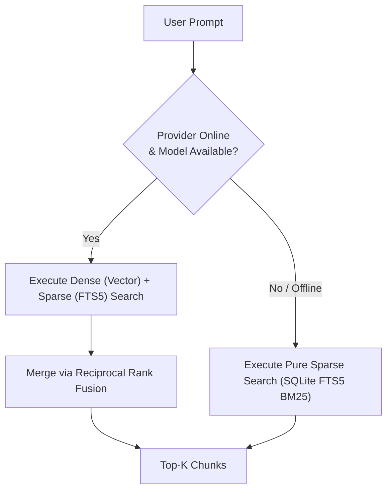

# Relay AI — Milestone 10.4: Vector & Hybrid Retrieval Engine
## Architecture Specification, pgvector Schema & Master Implementation Plan (Validated)

**Target Branch:** `feat/milestone-10-4-vector-hybrid-retrieval`  
**Base Branch:** `main`  
**Status:** Architecture Validated — Ready for Implementation Review  
**Prerequisites:** Milestone 10.2 (Cloud Sync) & Milestone 10.3 (Document Ingestion) merged into `main`.

---

## 1. Executive Summary & Architecture Validation

Milestone 10.4 delivers the dense vector embedding and hybrid retrieval capabilities of the Universal Context Engine (UCE).

Following formal architectural validation:
1. **Multi-Model Embedding Dimension Strategy:**
   - OpenAI `text-embedding-3-small` outputs 1536 dimensions by default, but natively supports Matryoshka Representation Learning (MRL) reduction to 768 dimensions.
   - Ollama `nomic-embed-text` outputs 768 dimensions natively and cannot scale up to 1536.
   - **Resolution:** A Dual-Vector Column schema (`embedding_1536` and `embedding_768`) is established on `document_chunks` with partial HNSW indexing.
   - **Strict Invariant:** Chunks are strictly tagged with `embedding_model` and `embedding_dimension`. Vectors from different models or different dimensions are **never silently truncated, zero-padded, or compared**. The similarity RPC strictly filters by `model_id`.
2. **PostgreSQL pgvector Schema:**
   - Utilizes Supabase `pgvector` with HNSW cosine distance indexing (`vector_cosine_ops`) with `m = 16, ef_construction = 64`.
   - RPC function `match_document_chunks` declared `SECURITY INVOKER` with explicit `WHERE user_id = auth.uid()` and project-level scoping.
   - Down migration script provided for clean rollback.
3. **Resilient Embedding Pipeline:**
   - Batch chunking (32 chunks per batch) with token ceiling guards.
   - Exponential backoff with jitter for HTTP 429 and network errors.
   - Local SQLite IEEE-754 binary floating-point cache (`embedding_cache`) keyed by `(sha256(content), model_id)` to eliminate duplicate API requests.
4. **Hybrid Retrieval with Reciprocal Rank Fusion (RRF):**
   - Blends dense semantic similarity and sparse keyword search (PostgreSQL `tsv_content` / SQLite `chunks_fts` BM25).
   - Standard RRF constant $k = 60$ with configurable weights ($w_{\text{dense}} = 0.6, w_{\text{sparse}} = 0.4$).
   - Seamless offline fallback to pure BM25 search when external embedding providers are unavailable.

---

## 2. Embedding Dimensions & Provider Compatibility

### A. Provider Dimensionality Analysis

| Provider | Model | Native Dims | MRL Configurable | Max Tokens | Supported Storage Column |
|---|---|---|---|---|---|
| **OpenAI** | `text-embedding-3-small` | 1536 | Yes (down to 768, 512) | 8,191 | `embedding_1536` or `embedding_768` |
| **OpenAI** | `text-embedding-3-large` | 3072 | Yes (down to 1536, 768) | 8,191 | `embedding_1536` or `embedding_768` |
| **Ollama** | `nomic-embed-text` | 768 | Yes (down to 512, 256) | 8,192 | `embedding_768` |
| **Mock** | `mock-embed-v1` | Configurable (768 or 1536) | Yes | N/A | Matched to test requirement |

### B. The Geometric Incompatibility Problem
Every embedding model projects text into a distinct, high-dimensional latent space. Even if two different models output the same dimension (e.g., OpenAI at 768 dims and Ollama at 768 dims), their coordinates represent completely different semantic features. Calculating cosine distance across different models produces meaningless noise. Furthermore, zero-padding a 768-dim vector to 1536 distorts vector magnitude, corrupts cosine angles, and causes pgvector dimension errors.

### C. The Dual-Column Model-Isolated Solution
To cleanly support both OpenAI (1536 default, or 768 MRL) and Ollama (768 native) without silent truncation or padding:

1. **Schema Columns:**
   - `embedding_1536 vector(1536)`: Populated when the active model produces 1536 dimensions.
   - `embedding_768 vector(768)`: Populated when the active model produces 768 dimensions.
   - `embedding_model text`: Identifies the exact model (e.g., `'openai/text-embedding-3-small'`, `'ollama/nomic-embed-text'`).
   - `embedding_dimension integer`: Records the exact dimension (1536 or 768).
2. **OpenAI Dimension Configuration:**
   The `OpenAIEmbeddingProvider` accepts an optional `dimension: int = 1536` parameter. If set to 768, OpenAI's API performs native Matryoshka reduction and normalizes the vector; the pipeline routes it to `embedding_768`.
3. **Query-Time Model Isolation:**
   The similarity search RPC requires `p_model_id text` and enforces:
   ```sql
   WHERE c.embedding_model = p_model_id
   ```
   This mathematically and architecturally ensures incompatible embeddings are never compared.
4. **Safe Re-Embedding Workflow:**
   When the user changes the embedding model in application settings:
   - Existing chunk embeddings for the previous model are preserved in SQLite cache.
   - A background `ReEmbeddingWorker` scans for chunks where `embedding_model != active_model_id` and computes new vectors.
   - If the user reverts to the previous model, cached embeddings are instantly reused without re-incurring API costs or processing delays.

---

## 3. PostgreSQL pgvector Schema & Migrations

### A. Up-Migration (`supabase/migrations/20261115000001_milestone_10_4_vector_retrieval.sql`)

```sql
-- 1. Enable pgvector extension
create extension if not exists vector;

-- 2. Add dual-vector columns and metadata to public.document_chunks
alter table public.document_chunks
  add column if not exists embedding_1536 vector(1536),
  add column if not exists embedding_768 vector(768),
  add column if not exists embedding_model text,
  add column if not exists embedding_dimension integer;

-- 3. Partial HNSW indexes for 1536 and 768 dimensions
-- Using partial indexes (WHERE ... IS NOT NULL) avoids indexing empty rows
create index if not exists idx_document_chunks_embedding_1536_hnsw
  on public.document_chunks
  using hnsw (embedding_1536 vector_cosine_ops)
  with (m = 16, ef_construction = 64)
  where embedding_1536 is not null;

create index if not exists idx_document_chunks_embedding_768_hnsw
  on public.document_chunks
  using hnsw (embedding_768 vector_cosine_ops)
  with (m = 16, ef_construction = 64)
  where embedding_768 is not null;

-- 4. Vector similarity search RPC with strict tenant isolation and model matching
create or replace function public.match_document_chunks(
  query_embedding_1536 vector(1536) default null,
  query_embedding_768 vector(768) default null,
  p_model_id text default 'openai/text-embedding-3-small',
  match_threshold float default 0.3,
  match_count int default 10,
  filter_project_id uuid default null,
  filter_document_id uuid default null
)
returns table (
  id uuid,
  document_id uuid,
  project_id uuid,
  chunk_index int,
  content text,
  metadata jsonb,
  similarity float
)
language sql stable security invoker
as $$
  select
    c.id,
    c.document_id,
    d.project_id,
    c.chunk_index,
    c.content,
    c.metadata,
    case
      when query_embedding_1536 is not null and c.embedding_1536 is not null
        then 1 - (c.embedding_1536 <=> query_embedding_1536)
      when query_embedding_768 is not null and c.embedding_768 is not null
        then 1 - (c.embedding_768 <=> query_embedding_768)
      else 0.0
    end as similarity
  from public.document_chunks c
  join public.documents d on d.id = c.document_id
  where c.user_id = auth.uid()
    and c.embedding_model = p_model_id
    and (filter_project_id is null or d.project_id = filter_project_id)
    and (filter_document_id is null or c.document_id = filter_document_id)
    and (
      (query_embedding_1536 is not null and c.embedding_1536 is not null and (1 - (c.embedding_1536 <=> query_embedding_1536)) >= match_threshold)
      or
      (query_embedding_768 is not null and c.embedding_768 is not null and (1 - (c.embedding_768 <=> query_embedding_768)) >= match_threshold)
    )
  order by similarity desc
  limit match_count;
$$;

-- 5. Keyword search RPC using existing tsv_content column
create or replace function public.search_document_chunks_keyword(
  query_text text,
  match_count int default 10,
  filter_project_id uuid default null,
  filter_document_id uuid default null
)
returns table (
  id uuid,
  document_id uuid,
  project_id uuid,
  chunk_index int,
  content text,
  metadata jsonb,
  rank float
)
language sql stable security invoker
as $$
  select
    c.id,
    c.document_id,
    d.project_id,
    c.chunk_index,
    c.content,
    c.metadata,
    ts_rank_cd(c.tsv_content, websearch_to_tsquery('english', query_text))::float as rank
  from public.document_chunks c
  join public.documents d on d.id = c.document_id
  where c.user_id = auth.uid()
    and (filter_project_id is null or d.project_id = filter_project_id)
    and (filter_document_id is null or c.document_id = filter_document_id)
    and c.tsv_content @@ websearch_to_tsquery('english', query_text)
  order by rank desc
  limit match_count;
$$;
```

### B. Down-Migration (`supabase/migrations/20261115000001_milestone_10_4_vector_retrieval_down.sql`)

```sql
drop function if exists public.search_document_chunks_keyword(text, int, uuid, uuid);
drop function if exists public.match_document_chunks(vector, vector, text, float, int, uuid, uuid);
drop index if exists public.idx_document_chunks_embedding_768_hnsw;
drop index if exists public.idx_document_chunks_embedding_1536_hnsw;
alter table public.document_chunks drop column if exists embedding_dimension;
alter table public.document_chunks drop column if exists embedding_model;
alter table public.document_chunks drop column if exists embedding_768;
alter table public.document_chunks drop column if exists embedding_1536;
```

---

## 4. Local SQLite Schema Updates & Binary Vector Caching

### A. Local SQLite Schema Migration
Local SQLite tables will be updated via migration in `src/context/db/migrations.py`:

```sql
-- Add embedding columns to local document_chunks table
ALTER TABLE document_chunks ADD COLUMN embedding_1536 BLOB;
ALTER TABLE document_chunks ADD COLUMN embedding_768 BLOB;
ALTER TABLE document_chunks ADD COLUMN embedding_model TEXT;
ALTER TABLE document_chunks ADD COLUMN embedding_dimension INTEGER;

-- Binary embedding cache
CREATE TABLE IF NOT EXISTS embedding_cache (
    content_hash TEXT NOT NULL,
    model_id TEXT NOT NULL,
    dimension INTEGER NOT NULL,
    embedding BLOB NOT NULL,
    created_at TIMESTAMP DEFAULT CURRENT_TIMESTAMP,
    PRIMARY KEY (content_hash, model_id)
);
CREATE INDEX IF NOT EXISTS idx_emb_cache_lookup ON embedding_cache(model_id, content_hash);
```

### B. High-Performance IEEE-754 Binary Serialization
Vectors are serialized into compact raw byte arrays using Python's `struct`:
- Packing: `struct.pack(f'{dimension}f', *vector)`
- Unpacking: `list(struct.unpack(f'{dimension}f', blob))`
- Storage efficiency: 768 dimensions = 3,072 bytes; 1536 dimensions = 6,144 bytes. Deserialization executes in <1 microsecond.

---

## 5. Embedding Provider Abstraction & Pipeline

### A. Interface (`src/providers/embeddings.py`)
```python
from __future__ import annotations
from abc import ABC, abstractmethod
from typing import Sequence

class EmbeddingProvider(ABC):
    @property
    @abstractmethod
    def provider_id(self) -> str:
        """e.g. 'openai', 'ollama', 'mock'"""
        ...

    @property
    @abstractmethod
    def model_id(self) -> str:
        """e.g. 'openai/text-embedding-3-small', 'ollama/nomic-embed-text'"""
        ...

    @property
    @abstractmethod
    def dimension(self) -> int:
        """1536 or 768"""
        ...

    @abstractmethod
    def embed_query(self, text: str) -> list[float]:
        """Embeds single query text; returns unit-normalized float list."""
        ...

    @abstractmethod
    def embed_documents(self, texts: Sequence[str]) -> list[list[float]]:
        """Embeds sequence of document chunk texts; returns list of unit-normalized float lists."""
        ...
```

### B. Pipeline Architecture (`src/context/embeddings/pipeline.py`)
- **Batch Processing**: Batches chunks into slices of 32 texts.
- **Cache Check**: Computes `sha256(chunk_text.strip())`. If cached for `model_id`, loads vector from SQLite. Only cache misses are dispatched to the external provider.
- **Rate Limit & Backoff**: Exponential backoff with jitter on HTTP 429 and 5xx responses ($1.0s, 2.0s, 4.0s, 8.0s \pm 20\%$).
- **Normalization Guarantee**: Enforces $\|\vec{v}\|_2 = 1.0 \pm 10^{-5}$ on all output vectors.

---

## 6. Hybrid Retrieval Engine & Reciprocal Rank Fusion

### A. RRF Scoring Algorithm
Dense semantic and sparse lexical ranks are combined via Reciprocal Rank Fusion:

$$RRF(d) = \frac{w_{\text{dense}}}{60 + \text{rank}_{\text{dense}}(d)} + \frac{w_{\text{sparse}}}{60 + \text{rank}_{\text{sparse}}(d)}$$

- Constant $k = 60$ prevents top-rank skew.
- Default weights: $w_{\text{dense}} = 0.6, w_{\text{sparse}} = 0.4$.
- Chunks matched by both dense and sparse queries receive amplified composite scores.

### B. Offline & Fault-Tolerant Fallback


---

## 7. Integration with Existing Relay AI Architecture

1. **Document Ingestion (`DocumentManager`)**:
   - `DocumentManager.ingest()` extracts text, creates chunks, and invokes `EmbeddingPipeline.embed_chunks()`.
   - Embeddings are persisted locally in `document_chunks` and staged into `SyncQueueManager` for cloud synchronization.
2. **Sync Worker (`SyncWorker`)**:
   - Outbox payload for `document_chunks` includes `embedding_1536` or `embedding_768` (as JSON float array), `embedding_model`, and `embedding_dimension`.
3. **Context Repository (`ContextRepository`)**:
   - Exposes `search_chunks(query, project_id=None, limit=5)` routing to `HybridRetriever`.
4. **Existing Regression Suite**:
   - All 342 existing tests remain 100% passing.

---

## 8. Implementation Phases & Testing Strategy

### Implementation Phases:
- **Phase 1: Embedding Provider Abstraction (`src/providers/embeddings.py`)**
  - Implement `EmbeddingProvider`, `OpenAIEmbeddingProvider`, `OllamaEmbeddingProvider`, `MockEmbeddingProvider`.
- **Phase 2: Local SQLite Binary Cache & Schema Updates**
  - Add SQLite migration for `embedding_cache` and chunk embedding columns.
- **Phase 3: Embedding Pipeline & Ingestion Integration**
  - Implement `EmbeddingPipeline` with batching, backoff, and caching.
  - Wire pipeline into `DocumentManager.ingest()`.
- **Phase 4: Supabase pgvector Migration & RPCs**
  - Create Supabase up and down SQL migration scripts.
- **Phase 5: Hybrid Retrieval Engine (`src/context/retrieval/hybrid.py`)**
  - Implement dense vector search, FTS5 BM25 search, and RRF rank merger.
  - Implement graceful offline degradation.
- **Phase 6: Comprehensive Test Suite & Verification**
  - Implement 7 new test files (+22 unit tests) ensuring 364/364 passing tests.

### Test Strategy Matrix:
| Test File | Target | Coverage |
|---|---|---|
| `tests/test_embedding_providers.py` | Providers | Mock, OpenAI, Ollama instantiation, dimensionality, API format, normalization. |
| `tests/test_embedding_pipeline.py` | Pipeline | Batching, backoff retries, SHA-256 binary caching hits/misses, deduplication. |
| `tests/test_vector_search.py` | Vector Search | Cosine similarity calculation, threshold filtering, model isolation verification. |
| `tests/test_keyword_search.py` | Keyword Search | FTS5 BM25 queries, punctuation handling, stemming, token matching. |
| `tests/test_hybrid_retrieval.py` | Hybrid RRF | Rank combination, score math, deduplication, tie-breakers. |
| `tests/test_retrieval_fallback.py` | Fallback | Offline behavior, provider error recovery, pure BM25 degradation. |
| `tests/test_vector_schema.py` | DDL / SQL | AST and syntax validation of Supabase up/down migrations and RPC functions. |

---

## 9. Plan Approval Check

Architecture validation is complete. No production application code has been implemented.
Standing by for formal user approval to proceed with Phase 1.
